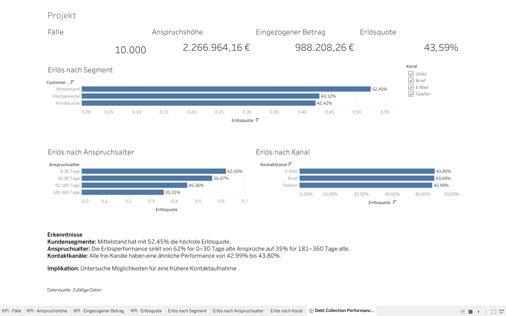

# Debt Collection Analytics

## Project Overview

This project analyzes a synthetic dataset of 10,000 debt collection cases to demonstrate how data analytics can support operational decision-making in receivables management.

The analysis focuses on recovery performance across customer segments, claim age groups, and contact channels.

**Note:** All data is synthetically generated. The results do not represent the actual performance of EOS or any other debt collection company.

## Dashboard Preview



## Technologies

- Python – synthetic data generation and data preparation
- SQLite – data storage and SQL-based analysis
- SQL – KPI calculation and performance analysis
- Tableau Public – dashboard and data visualization

## Project Structure

```text
debt-collection-analytics/
├── data/
│   ├── raw/
│   └── processed/
├── sql/
│   └── analysis.sql
├── src/
│   ├── generate_data.py
│   ├── prepare_data.py
│   ├── create_database.py
│   └── run_analysis.py
├── .gitignore
├── requirements.txt
└── README.md
```

## Key Performance Indicators

- Number of collection cases
- Total claim amount
- Total recovered amount
- Weighted recovery rate
- Settlement rate

## Key Findings

Based on the synthetic dataset:

- Overall weighted recovery rate: **43.59%**
- The Mittelstand segment achieved the highest weighted recovery rate at **52.45%**.
- Recovery performance decreased with increasing claim age, from **62.00%** for claims aged 0–30 days to **35.31%** for claims aged 181–360 days.
- Recovery rates across contact channels were very similar, ranging from **42.99% to 43.80%**.

These findings reflect the assumptions used to generate the synthetic dataset and should not be interpreted as empirical evidence.

## How to Run

1. Install the required Python packages:

   ```bash
   pip install -r requirements.txt
   ```

2. Generate the synthetic dataset:

   ```bash
   python src/generate_data.py
   ```

3. Prepare and validate the data:

   ```bash
   python src/prepare_data.py
   ```

4. Create the SQLite database:

   ```bash
   python src/create_database.py
   ```

5. Run the SQL analyses:

   ```bash
   python src/run_analysis.py
   ```

## Purpose

The goal of this project is to demonstrate practical skills in data preparation, SQL-based analysis, KPI development, and data visualization in the context of debt collection analytics.